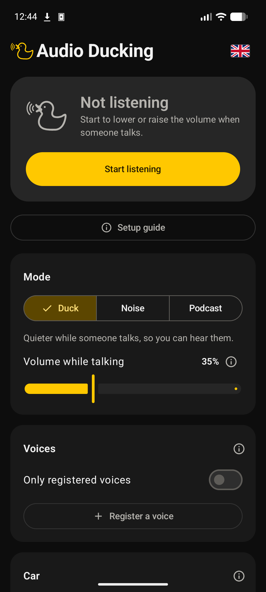
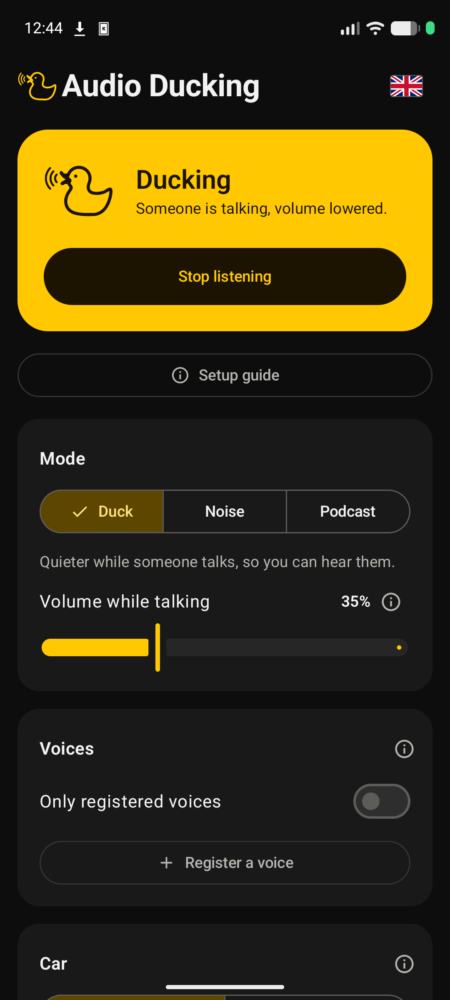
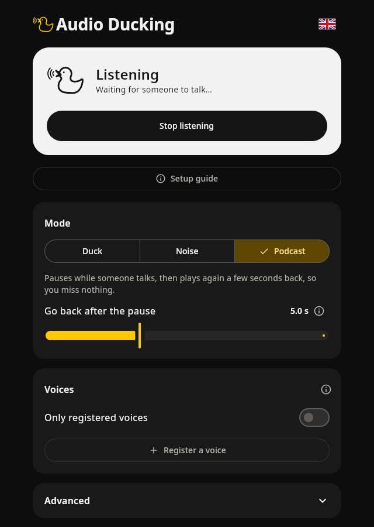

<p align="center">
  
</p>

<h1 align="center">Audio Ducking</h1>

<p align="center">
  Masz dość ciągłego kręcenia głośnością, gdy ktoś zaczyna mówić? <br>Audio Ducking przychodzi z pomocą.<br><br>
  Dostępne na: Androida, Linuksa i Windowsa
</p>

<p align="center">
  <a href="README.md">🇬🇧 English</a> ·
  <a href="#jak-to-działa">Jak to działa</a> ·
  <a href="#budowanie-ze-źródeł">Budowanie</a>
</p>

---

<p align="center">
  
  &nbsp;
  
  &nbsp;
  
</p>

## O projekcie
Aplikacja powstała najpierw jako pomoc, żeby nie musieć kręcić głośnością radia, gdy prowadzisz samochód i zaczynasz z kimś rozmawiać, ale szybko rozrosła się w coś większego, czego można używać praktycznie w każdym otoczeniu.
Audio Ducking nasłuchuje przez mikrofon,
rozpoznaje **ludzką mowę** (a ignoruje muzykę, stukanie w klawiaturę, ruch uliczny…) i ścisza lub pauzuje
to, co gra, aż rozmowa się skończy.

Aplikacja powstała jako moja **praca inżynierska**.
Cały dźwięk jest przetwarzany na urządzeniu: **nic nie jest nagrywane, zapisywane ani nigdzie wysyłane.** Aplikacja na Androida **nie ma uprawnienia do internetu**, więc nie musisz się martwić żadnym śledzeniem.

## Funkcje

| | |
|---|---|
| 🦆 **Tryb „Ciszej”** | Ścisza urządzenie do ustalonego poziomu, gdy ktoś mówi. |
| 🔊 **Tryb „Głośniej”** | Podgłaśnia urządzenie, żeby dało się słuchać mimo rozmowy. |
| 🎧 **Tryb „Podcast”** | Pauzuje odtwarzanie, gdy ktoś mówi, a potem wznawia kilka sekund *wcześniej*, żeby nie umknęło Ci ani słowo. |
| 🗣️ **Zarejestrowane głosy** | Opcjonalnie reaguje tylko na zarejestrowane osoby (rozpoznawanie mówcy), np. na partnera, ale nie na obcych w pociągu. |
| 🚗 **Samochód** (Android) | Podgłaśnia, gdy jedziesz szybciej lub przyspieszasz |
| ⚡ **Kafelek szybkich ustawień** | Włączanie i wyłączanie z panelu powiadomień bez otwierania aplikacji. |
| 🫧 **Pływający status** | Mały dymek nad innymi aplikacjami, który pokazuje, czy aplikacja nasłuchuje lub ścisza. |
| 🌍 **4 języki** | English, Polski, Deutsch, Español (więcej w przyszłości). Jest też wbudowany przewodnik konfiguracji. |

<p align="center">
  
</p>


## Jak to działa

1. **Nasłuch.** Mikrofon jest odczytywany bez przerwy z częstotliwością 16 kHz, na Androidzie w usłudze pierwszoplanowej.
2. **Czy to mowa?** Mniej więcej dwa razy na sekundę ostatnia sekunda dźwięku trafia do
   [CED](https://github.com/RicherMans/CED), klasyfikatora dźwięków wytrenowanego na zbiorze Google AudioSet
   (527 klas dźwięków). Jeśli wynik dla klasy *Speech* przekracza próg, ktoś mówi.
3. **Bramka mowy.** Krótkie przerwy między zdaniami nie powinny powodować skakania muzyki w górę i w dół.
   Dlatego ściszenie zaczyna się przy mowie, *trwa* jeszcze chwilę po jej ustaniu i przetrwa krótką pauzę,
   jeśli ktoś w tym czasie odpowie.
4. **Czyj to głos?** *(opcjonalnie)* Model [ERes2Net](https://github.com/modelscope/3D-Speaker) zamienia mowę
   w „odcisk” głosu (embedding), który jest porównywany (podobieństwo cosinusowe) z zarejestrowanymi
   głosami. Rejestracja polega na przeczytaniu na głos krótkiego tekstu. Silero VAD wycina
   ciszę, a dla większej odporności można dodać odciski z muzyką w tle i echem pomieszczenia.
5. **Akcja.** Głośność zmienia się przez systemowy mikser, a w trybie podcastu odtwarzacz jest pauzowany i cofany
   przez sterowanie multimediami.

**Tryb samochodowy** działa równolegle: przelicza prędkość z GPS na stopnie głośności, dodaje wzmocnienie przy przyspieszaniu
oraz gdy rośnie hałas w tle. Każda zmiana jest wygładzana, więc głośność nigdy nie skacze.

### Różnice między platformami

| | Android | Linux | Windows |
|---|---|---|---|
| Głośność | `AudioManager` | PipeWire `wpctl` / PulseAudio `pactl` | Core Audio `IAudioEndpointVolume` (JNA) |
| Pauza / odtwarzanie | Zdarzenia klawiszy multimedialnych | MPRIS przez D-Bus | Klawisz play/pause |
| Cofanie (podcast) | `MediaSession` (wymaga dostępu do powiadomień) | MPRIS `Seek` | – |
| Działanie w tle | Usługa pierwszoplanowa + kafelek szybkich ustawień | Okno aplikacji | Okno aplikacji |

## Technologie

- **Kotlin Multiplatform** i **Compose Multiplatform**: jeden interfejs i jeden potok detekcji dla Androida i desktopu
- **[sherpa-onnx](https://github.com/k2-fsa/sherpa-onnx)** (ONNX Runtime) do wnioskowania na urządzeniu
- Modele: **CED-base** (tagowanie dźwięku, int8), **ERes2Net** (weryfikacja mówcy), **Silero VAD**
- Android: usługa pierwszoplanowa, `TileService`, okno nakładki, prędkość GPS z `LocationManager`
- Desktop: JNA (Windows Core Audio), D-Bus i narzędzia wiersza poleceń PipeWire (Linux)

## Struktura projektu

```
shared/                 Moduł Kotlin Multiplatform
  src/commonMain/       UI (Compose), przetwarzanie mowy, bramka mowy, tryby, logika trybu samochodowego, ustawienia, tłumaczenia
  src/desktopMain/      Start aplikacji desktopowej, mikrofon, sterowanie głośnością i multimediami dla Linuksa/Windowsa
  src/commonTest/       Testy jednostkowe (bramka mowy, procesor, tryb samochodowy…)
app/                    Aplikacja na Androida: usługa, kafelek szybkich ustawień, nakładka, ładowanie modeli
models/                 Modele ONNX i fragmenty muzyki używane do augmentacji głosu
packaging/              Skrypty budujące APK, AppImage i przenośną wersję dla Windowsa
.github/workflows/      CI i automatyczne wydania
```

## Budowanie ze źródeł

Wymagania: JDK 21, Android SDK (dla aplikacji na Androida). Modele są już w `models/`.

```bash
# Uruchomienie wersji desktopowej
./gradlew :shared:run

# Testy
./gradlew :shared:desktopTest

# APK (debug)
./gradlew :app:assembleDebug

# Paczki wydaniowe (opis na początku każdego skryptu)
packaging/build-apk.sh
packaging/build-appimage.sh
packaging/build-windows.sh    # budowanie wersji dla Windowsa z Linuksa przez wine
```

Wypchnięcie taga, np. `v1.0.0`, sprawia, że GitHub Actions buduje wszystkie paczki i dołącza je do wydania.

## Uprawnienia (Android)

| Uprawnienie | Po co |
|---|---|
| Mikrofon | Żeby słyszeć, że ktoś mówi. Dźwięk nigdy nie opuszcza urządzenia. |
| Powiadomienia | Powiadomienie „nasłuchuję”, które utrzymuje usługę przy życiu. |
| Lokalizacja *(tylko tryb samochodowy)* | Prędkość i przyspieszenie z GPS. |
| Wyświetlanie nad innymi aplikacjami *(opcjonalnie)* | Pływający dymek statusu. |
| Dostęp do powiadomień *(opcjonalnie)* | Cofanie w trybie podcastu. |

## Ograniczenia

- iOS nie jest wspierany: system nie pozwala aplikacjom zmieniać głośności systemowej ani sterować odtwarzaniem w innych aplikacjach.
- macOS nie jest jeszcze wspierany. Wymagałby natywnej obsługi głośności i multimediów.
- Rozpoznawanie mówcy jest mniej pewne przy głośnej muzyce w tle. Opcja *dodatkowych próbek* w tym pomaga, choć może nie działać idealnie. Umieszczenie mikrofonu blisko miejsca, w którym toczy się rozmowa, poprawi rozpoznawanie.

## Licencja

[GPL-3.0](LICENSE) © 2026 nikoraasu.
Dołączone modele i muzyka mają własne licencje. Szczegóły w [THIRD_PARTY_NOTICES.md](THIRD_PARTY_NOTICES.md).
